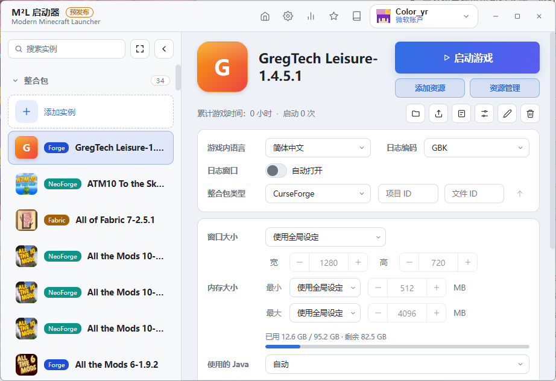
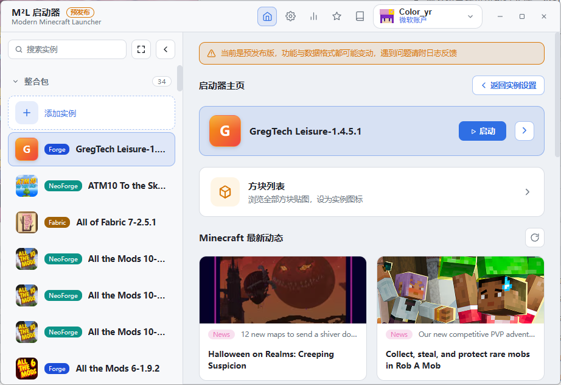
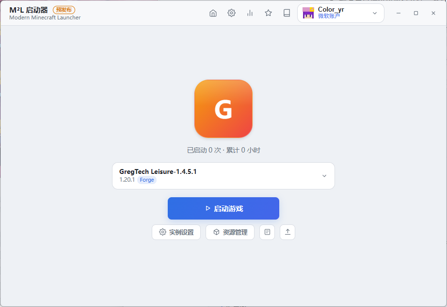
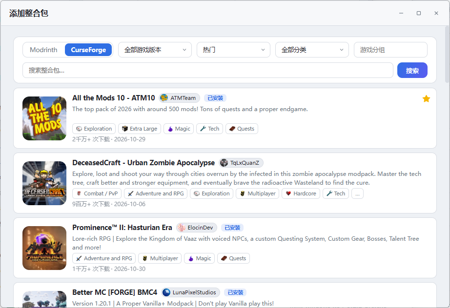
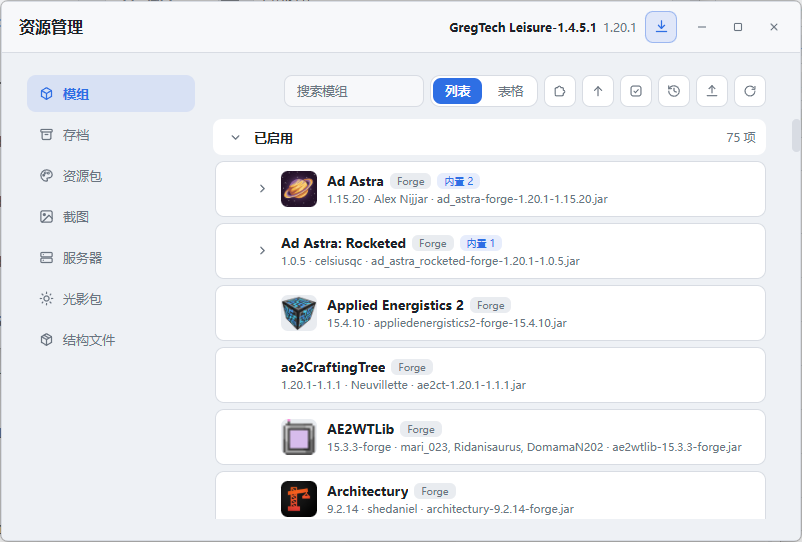
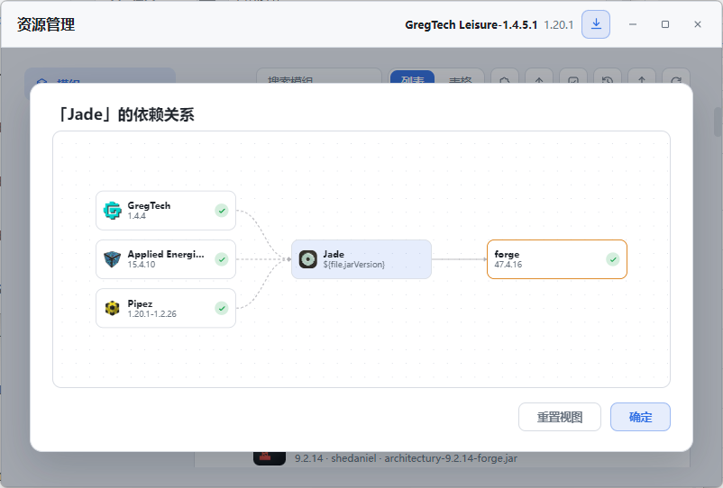
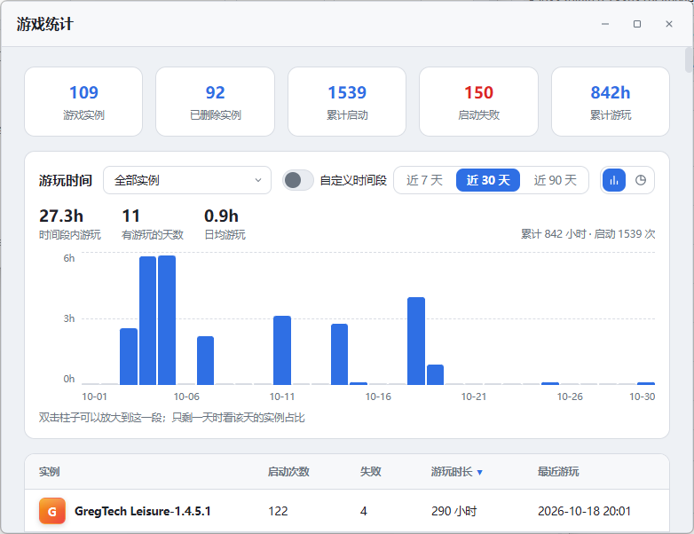
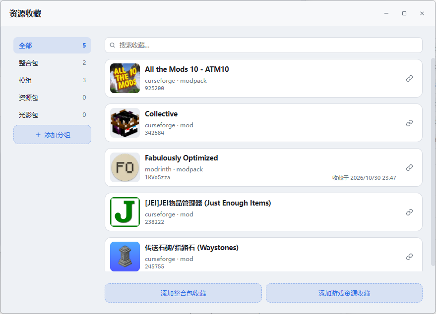
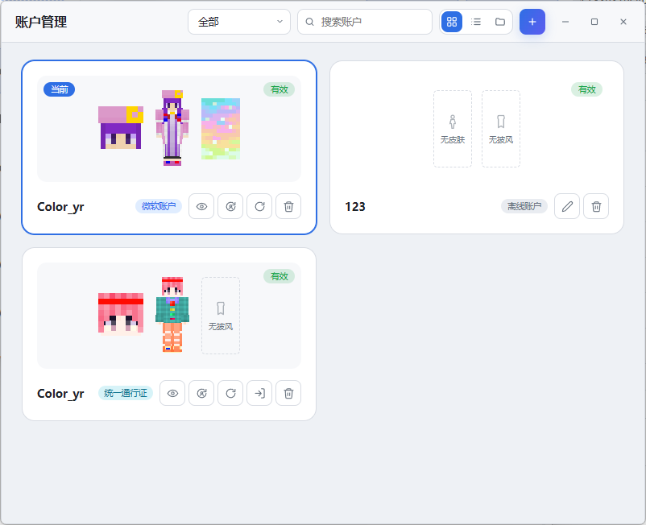

<p align="center">
  
</p>

# ModernMinecraftLauncher (M²L)
~~现代化改装我的世界启动器~~

[ColorMC](https://github.com/Coloryr/ColorMC) 的迭代软件，现代化 Minecraft 启动器。

**预览版已发布，欢迎测试与提出问题**

> **重要限制**：未登录过微软正版账户时，启动器禁止启动离线账户。请先添加并登录一个微软账户。

<p align="center">
  
</p>

## 功能

| 模块 | 说明 |
| --- | --- |
| 实例 | 新建、导入（文件夹 / 压缩包 / URL）、重命名、分组排序、删除；多个实例可同时运行 |
| 加载器 | Forge、NeoForge、Fabric、Quilt、Cleanroom、OptiFine、LiteLoader，以及自定义加载器 |
| 启动 | 内存 / 窗口 / Java / GC / 渲染器（游戏 26.2 起）；自定义 JVM 与游戏参数、附加 classpath；启动前 / 后命令支持占位符、整行写法与按扩展名挑解释器；自定义执行 / 自定义 JSON 启动配置；自定义服务器与快速进服 |
| 整合包 | CurseForge / Modrinth 搜索、详情、按文件安装（带进度与取消） |
| 资源管理 | 模组（分组 / 启用停用 / 备注 / 检查依赖 / 更新 / 整页依赖图）、资源包、光影包、存档（备份与还原）、截图、结构文件、数据包、服务器列表 |
| 账户 | 微软 OAuth、Nide8、Authlib-Injector、LittleSkin、自建 LittleSkin、离线（需先登录过微软账户）六种认证 |
| Java | 扫描本机 Java；从 Adoptium / Zulu / OpenJ9 / Foojay 下载 JRE / JDK |
| 下载 | 多线程、断点续传、哈希校验，带独立的下载管理窗口 |
| 渲染 | 从客户端 jar 离线渲染方块 / 物品图标；方块另有 2D 平面贴图，可按顶 / 侧 / 底面查看；皮肤、披风、头像的 2D / 3D 绘制，渲染后可以设置为实例图标 |
| 迁移 | 从 ColorMC 迁移数据；导入 `.minecraft`（官方 / HMCL / PCL）；MMC 通过实例导入 |
| 联机(制作中) | 陶瓦联机：正版账户验证、创建 / 加入房间、邀请码与直连地址；映射大厅预留 |
| 统计 | 每日游玩时间图、实例明细、启动次数与失败统计 |
| 手柄 | SDL3 读取手柄并映射到键鼠：组合键、连续 / 循环按下、轴区间、Xbox / PlayStation 外观；鼠标模式与游戏内模式可各用一套按钮绑定；游戏内输入按需开启，标题栏检测到手柄时有快捷入口 |
| 分发 | 实例导出（直接压缩 / CurseForge / Modrinth / MMC / HMCL）、生成实例信息、服务器包（实例 + 启动器配置）、服务器实例（MML / HMCL）与可直接导入 MMC / Prism 的服务器包 |
| 界面 | 多窗口与单窗口两种模式，暗色 / 亮色 / 跟随系统，中英双语；可导入自定义主页面、样式包，或整页重写主窗口 |
| 数据升级 | 启动时把旧版本的下载索引自动升级到新存储（带进度、可中断续跑），完成后发系统通知 |
| 云同步(制作中) | 可以将实例信息，实例存档上传至服务器保存，进行存档云同步等操作 |

## 截图

| 启动器主页 | 实例主页 |
| --- | --- |
|  |  |
| **整合包搜索** | **资源管理** |
|  |  |
| **模组依赖关系** | **游玩统计** |
|  |  |
| **资源收藏** | **账户管理** |
|  |  |

## 快速上手

从源码构建后运行程序，首次使用建议按这个顺序：

1. 在顶栏的账户选择器里添加账户；离线账户填名字即可，微软账户走设备码登录。
2. 点「添加游戏实例」新建实例，或导入压缩包 / 文件夹 / 在线地址。
3. 选中实例点启动；启动时自动扫描 Java 并按版本挑选，首次启动还会补全核心、运行库与资源文件。

完整说明见[软件手册](docs/README.md)。

## 构建与运行

### 环境要求

- **通用**：Rust stable（edition 2024，需 1.89+）、Node.js 24、`cargo install tauri-cli --version "^2" --locked`。
- **Windows**：MSVC 工具链、Visual Studio 生成工具（勾选「使用 C++ 的桌面开发」）、WebView2 运行时。
- **Linux**：WebKitGTK 4.1、GTK 3、libappindicator、librsvg、patchelf、libxdo，以及 D-Bus 与 libudev 开发包。
- **macOS**：Xcode Command Line Tools。

Rust workspace 在仓库根目录，首次构建会编译全部内核与桌面壳，耗时较长。Debian / Ubuntu 的 apt 命令、
AppImage 与 Flatpak 的额外依赖见[开发与构建](docs/development.md)。

克隆仓库后先跑一次初始化脚本：

```bash
build/init.ps1      # Windows
bash build/init.sh  # Linux / macOS / Git Bash
```

只装 `mml-vue` 的 npm 依赖并检查 `cargo tauri`，不构建也不启动程序。执行策略拦脚本时用
`powershell -ExecutionPolicy Bypass -File .\build\init.ps1`。

### 开发运行

```bash
cd mml-gui
.\tauri.ps1 dev        # Linux / macOS 用 bash tauri.sh dev
```

先还原 vendor 插件（`tauri-plugin-decoration` 的 patch），再起 Vite 与桌面窗口，**端口 1420 必须空闲**；
改前端热更新，改 Rust 重新编译。

只跑前端用 `build/dev-frontend.ps1`（bash 版 `.sh`）：它只配合单独 `cargo run` 的 debug 后端，
`tauri dev` 已自带 Vite，不要同时起。浏览器直接打开 `http://localhost:1420/?window=<kind>`
只能看到没有 IPC 数据的空状态。

### 出包

| 目标 | 命令 | 产物 |
| --- | --- | --- |
| 正式发布 | `build/build-release.ps1`（或 `.sh`） | `build_out/` 下带版本号的安装包 |
| 预发布（本地快速） | `build/build-prerelease.ps1`（或 `.sh`） | `target/prerelease/mml-gui-<arch>.exe`，不打包 |
| Linux 附加包 | `bash build/package-flatpak.sh` / `bash build/package-arch.sh` | `build_out/` 下的 `.flatpak` 与 `.pkg.tar.zst` |

Windows 默认出 x64 / arm64，只要一种用 `-Arch x64`；Linux / macOS 本地只出当前架构，各架构齐全靠 CI。
正式发布是 fat LTO、体积最小，本地预发布是 thin LTO、快很多；两种预发布都带「预发布版」徽章与 DevTools。
产物命名、交叉编译参数与 macOS 签名见[开发与构建](docs/development.md)。

### 版本与发布

版本号写在仓库根的 `docs/version`（一行纯数字，如 `0.1.9`），构建前自动同步进应用清单。
预览版由发版标签的 `-pre` 后缀表示（如 `v0.1.9-pre`）；标签只是触发器，数字部分必须与文件一致。
`testbuild` 只验证结果、产物全部丢弃。推送后由 GitHub Actions 按平台并行构建并发 Release，安装包统一收集到 `build_out/`（不入库）。
发版流程见[自动化构建](docs/development.md#自动化构建github-actions)，产物命名与签名见[开发与构建](docs/development.md)。

常用开发命令（重新生成 IPC 契约、整仓检查、lint、测试、图标）与 IPC 生成规则见
[开发与构建](docs/development.md)。

## 项目结构

```text
ModernColoryrMinecraftLauncher/
├─ Cargo.toml                      Rust workspace 清单（收编内核、桌面壳、云同步服务端与 ipc-gen）
├─ check.ps1 / check.sh            整仓检查入口：先还原 vendor 插件，再 cargo check
├─ mml-core/                       启动器内核，Rust workspace 主体
│  ├─ src/                         内核总入口：init / load / stop
│  ├─ mml-base/                    基础库：JSON/TOML、哈希、压缩包、事件、版本号
│  ├─ mml-config/                  全局配置读写、延迟保存与版本迁移
│  ├─ mml-log/                     异步日志
│  ├─ mml-link/                    资源映射：公共目录索引与实例硬链接
│  ├─ mml-upgrade/                 按版本分模块的数据升级步骤
│  ├─ mml-names/                   目录 / 文件名常量、保留 uuid、i18n
│  ├─ mml-game/                    实例创建 / 导入 / 启动、版本与加载器、整合包
│  ├─ mml-downloader/              多线程下载、断点续传、哈希校验
│  ├─ mml-auth/                    离线 / 微软 OAuth / Nide8 / Authlib-Injector 认证
│  ├─ mml-jvms/                    Java 扫描、版本与架构匹配
│  ├─ mml-net/                     HTTP 客户端与 Mojang / Modrinth / CurseForge 等 API
│  ├─ mml-ipc/                     启动器与游戏进程的本机 IPC
│  ├─ mml-nbt/                     NBT 与区块读写
│  ├─ mml-analysis/                崩溃日志分析
│  ├─ mml-cloud/                   云同步客户端
│  ├─ mml-gamepad/                 手柄读取与按键映射
│  ├─ mml-skin/                    皮肤类型识别与位图读写
│  ├─ mml-skin-draw/               皮肤 / 披风 / 头像的 2D / 3D 渲染
│  ├─ mml-tex-draw/                方块 / 物品图标离线渲染
│  ├─ mml-gpu/                     公共 wgpu 离屏渲染后端
│  ├─ mml-sys/                     进程 / 路径 / 内存 / 剪贴板等系统交互
│  ├─ mml-tools/                   启动器自带的工具链（`tools/` 下的 Python 运行时等）
│  └─ mml-testutil/                测试临时目录工具
├─ mml-gui/                        Tauri 2 桌面壳
│  ├─ src-tauri/src/windows/       各窗口规格、模型与 IPC；registry / geometry / lifecycle 是共用窗口逻辑
│  ├─ src-tauri/src/dtos/          跨 IPC 的 DTO
│  ├─ src-tauri/src/               入口、GUI 配置、托盘、图片 / 自定义页面协议
│  ├─ src-tauri/tests/             集成测试与迁移样本
│  ├─ src-tauri/capabilities/      Tauri 权限
│  └─ vendor/                      tauri-plugin-decoration 的 patch 与还原脚本
├─ mml-vue/                        前端（Vue 3 + Vite + TypeScript）
│  ├─ src/windows/                 各窗口页面，与后端窗口一一对应
│  ├─ src/components/              跨窗口组件；ui/ 是基础控件
│  ├─ src/lib/                     命令包装、i18n、主题、自定义界面等
│  ├─ src/styles/                  全局样式与主题变量
│  ├─ src/composables/             通用组合式函数
│  ├─ src/generated/               gen-ui 生成的控件清单与样式出口
│  └─ scripts/gen-ui.ts            生成 UI 出口
├─ mml-ipc/                        npm 契约包
│  └─ src/
│     ├─ types/                    生成的 DTO，按来源 .rs 拆分
│     ├─ bindings.ts               生成的命令包装
│     ├─ listens.ts                生成的事件名、payload 映射与订阅函数
│     ├─ home.ts                   自定义主页 window.mml 契约（手写）
│     └─ customUi.ts               自定义界面类型与上下文（手写）
├─ ipc-gen/                        IPC 代码生成器
│  ├─ src/                         扫描 Rust 源码并生成 TypeScript
│  └─ macros/                      命令 / 事件标记过程宏（gui-macros）
├─ custom/                         四种自定义界面示例，各自构建成可导入的 zip
│  ├─ custom-main-demo/            自定义主页面（home）
│  ├─ custom-ui-demo/              整页主题 · Vue 组件（page）
│  ├─ custom-ui-html-demo/         整页主题 · HTML（page）
│  └─ custom-ui-css-demo/          自定义 CSS（css）
├─ mml-theme-studio/               独立的主题开发工具（Tauri + Vue + Monaco）
│  ├─ src/                         编辑器界面
│  ├─ src-tauri/src/               项目 / 文件 / 子进程 / 预览服务
│  └─ preview/                     预览脚本
├─ mml-cloud-server/               存档云同步服务端：独立 HTTP 服务（axum + tokio）
│  ├─ src/                         路由、鉴权、配额与差异 ZIP 存储
│  ├─ tests/                       协议与存储的集成测试
│  └─ cloud-server.example.json    配置样例：两种密钥与每账户配额
├─ .github/workflows/              GitHub Actions：三平台构建与发版
├─ build/
│  ├─ version.mjs                  版本解析：读 docs/version，可被 MML_VERSION 覆盖
│  ├─ set-version.mjs              把解析到的版本同步到应用清单
│  ├─ package-release.mjs          安装包按版本重命名后收集到 build_out/
│  ├─ linux/                       桌面文件与 AppStream 元数据
│  └─ *.ps1 / *.sh                 初始化、开发、正式发布、预发布、Flatpak / Arch 打包脚本
├─ design/                         程序图标 SVG 源文件
├─ docs/                           软件手册、服务器实例指导、开发与构建、更新日志、开源许可
│  └─ version                      版本号，构建从这里取，见「版本与发布」
└─ pics/                           README 截图
```

各子项目的详细说明见其 README：[mml-gui](mml-gui/README.md)、[mml-vue](mml-vue/README.md)、
[mml-ipc](mml-ipc/README.md)、[custom](custom/README.md)、[mml-theme-studio](mml-theme-studio/README.md)、
[mml-cloud-server](mml-cloud-server/README.md)。

服务器实例更新器 `mml-server-sync` 单独维护在 [Coloryr/mml-server-sync](https://github.com/Coloryr/mml-server-sync)，
本仓库只保留构建好的 jar（`mml-gui/src-tauri/resources/mml-server-sync.jar`，随 exe 内嵌）。

## 文档

| 文档 | 内容 |
| --- | --- |
| [软件手册](docs/README.md) | 完整软件手册：第一次启动、实例、资源、账户、Java、联机、设置、数据备份与排错 |
| [服务器实例操作指导](docs/server-instance.md) | 生成、发布、MML / HMCL / MMC / Prism 玩家导入、更新与排错 |
| [开发与构建](docs/development.md) | 技术栈、IPC 契约、构建配置、GitHub Actions 发版 |
| [开源许可](docs/licensing.md) | 内嵌组件、前端库、Rust 依赖、第三方服务与许可说明 |
| [更新日志](docs/changelog.md) | 每个版本的可见变化 |

## 更新日志

当前版本见 [`docs/version`](docs/version)。

## 未来计划
- 实验性功能：跨版本迁移助手
- 实验性功能：模组二分模式
- 实验性功能：.minecraft兼容

## 待完成列表
- MCMOD搜索
- 存档云同步(ColorMC)
- 映射大厅 / 联机
- 启动器自更新

## 反馈

遇到问题请带上运行目录下的 `logs.log` 与复现步骤，提交到
[GitHub Issues](https://github.com/Coloryr/ModernMinecraftLauncher/issues)。

## 许可证

本项目以 **Apache-2.0** 发布，全文见 [LICENSE](LICENSE)。
随包分发的第三方组件与它们各自的许可见[开源许可](docs/licensing.md)。
