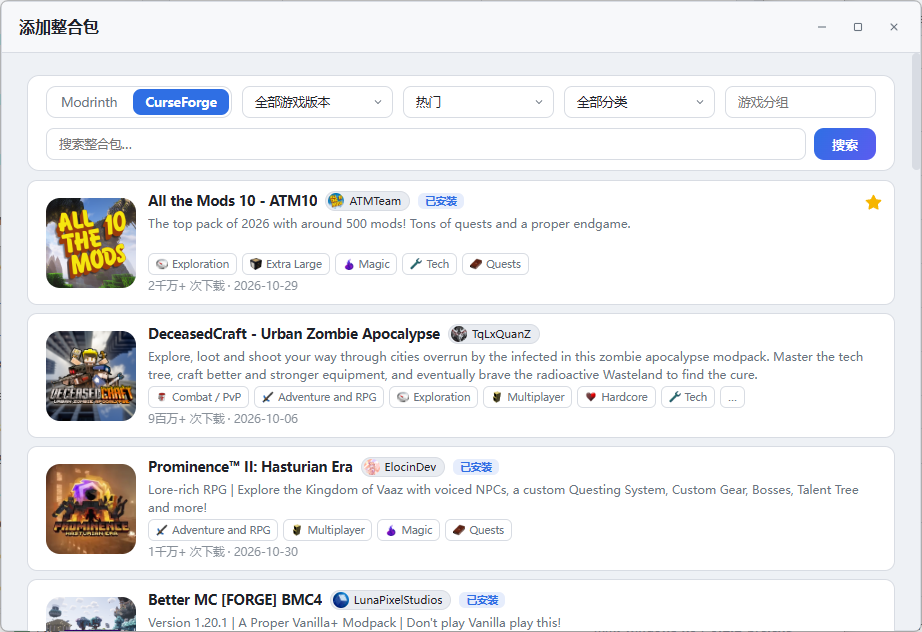
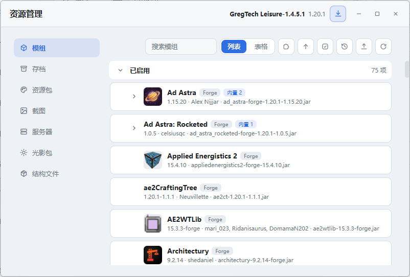
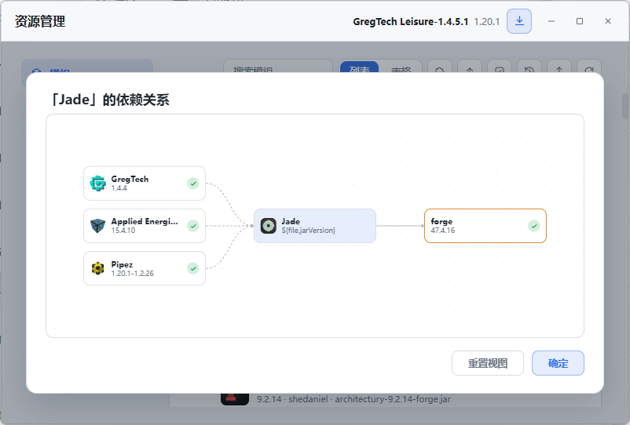
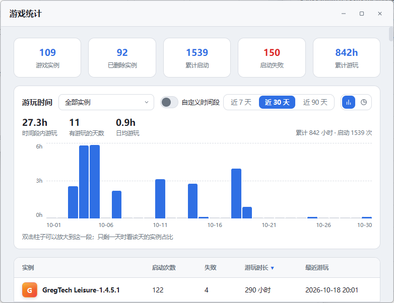
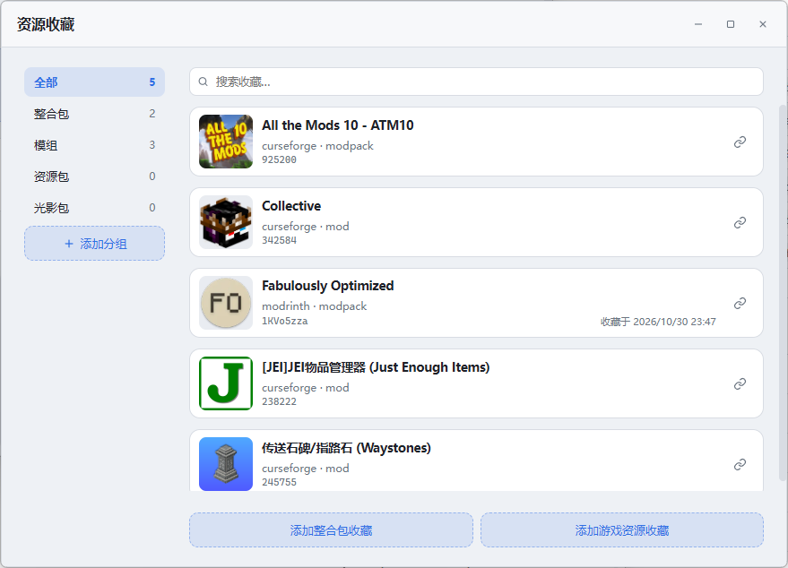
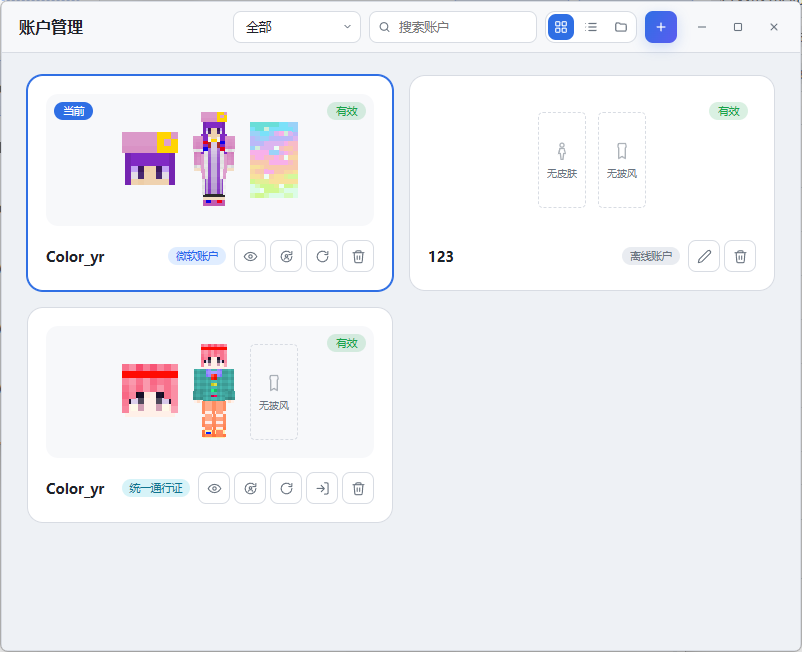

<p align="center">
  
</p>

# ModernMinecraftLauncher (M²L)

[ColorMC](https://github.com/Coloryr/ColorMC) 的迭代软件，一个 Minecraft 启动器。

**预览版，欢迎测试与提出问题**

> **重要限制**：未登录过微软正版账户时，启动器禁止启动离线账户。请先添加并登录一个微软账户。

<p align="center">
  
</p>

## 功能

| 模块 | 说明 |
| --- | --- |
| 实例 | 新建、导入（文件夹 / 压缩包 / URL）、重命名、分组排序、删除；多个实例可同时运行 |
| 加载器 | Forge、NeoForge、Fabric、Quilt、Cleanroom、OptiFine、LiteLoader，以及自定义加载器 |
| 整合包 | CurseForge / Modrinth 搜索、详情、按文件安装（带进度与取消） |
| 资源管理 | 模组（分组 / 启用停用 / 备注）、资源包、光影包、存档（备份与还原）、截图、结构文件、数据包、服务器列表 |
| 账户 | 离线（需先登录过微软账户）、微软 OAuth、Nide8、Authlib-Injector、LittleSkin、自建 LittleSkin 六种认证 |
| Java | 扫描本机 Java；从 Adoptium / Zulu / OpenJ9 / Foojay 下载 JRE / JDK |
| 下载 | 多线程、断点续传、哈希校验，带独立的下载管理窗口 |
| 渲染 | 从客户端 jar 离线渲染方块 / 物品图标；皮肤、披风、头像的 2D / 3D 绘制 |
| 迁移 | 从 ColorMC 迁移数据；导入 `.minecraft`（官方 / HMCL / PCL）；MMC 通过实例导入 |
| 联机(制作中) | 陶瓦联机：正版账户验证、创建 / 加入房间、邀请码与直连地址；映射大厅预留 |
| 统计 | 每日游玩时间图、实例明细、启动次数与失败统计 |
| 分发 | 实例导出（直接压缩 / CurseForge / Modrinth / MMC / HMCL）、生成实例信息、服务器包、服务器实例（MML / HMCL） |
| 界面 | 多窗口与单窗口两种模式，暗色 / 亮色 / 跟随系统，中英双语；可导入自定义主页面、样式包，或整页重写主窗口 |

## 截图

| 启动器主页 | 实例主页 |
| --- | --- |
|  |  |
| **整合包搜索** | **资源管理** |
|  |  |
| **模组依赖关系** | **游玩统计** |
|  |  |
| **资源收藏** | **账户管理** |
|  |  |

## 快速上手

从源码构建后运行程序，首次使用建议按这个顺序：

1. 在顶栏的账户选择器里添加账户；离线账户填名字即可，微软账户走设备码登录。
2. 点「添加游戏实例」新建实例，或导入压缩包 / 文件夹 / 在线地址。
3. 选中实例点启动；启动时自动扫描 Java 并按版本挑选，首次启动还会补全核心、运行库与资源文件。

完整说明见[软件手册](docs/README.md)。

## 构建与运行

### 环境要求

- **通用**：Rust stable（edition 2024，需 1.85+）、Node.js 24 LTS（Vite 8 要求 20.19+ / 22.12+，CI 用 24）、
  `cargo install tauri-cli --version "^2" --locked`（提供 `cargo tauri`）。
- **Windows**：Rust 的 MSVC 工具链、Visual Studio 生成工具（勾选「使用 C++ 的桌面开发」）、
  WebView2 运行时（Windows 11 和较新的 Windows 10 已自带）。
- **Linux**：Tauri 2 需要的 WebKitGTK 4.1、GTK 3、libappindicator、librsvg、patchelf、libxdo，
  以及 `mml-sys`「在文件管理器中显示」用的 D-Bus 开发包、手柄读取用的 libudev 开发包；
  Debian / Ubuntu 上：

  ```bash
  sudo apt install libwebkit2gtk-4.1-dev libgtk-3-dev libayatana-appindicator3-dev \
      librsvg2-dev patchelf libxdo-dev libdbus-1-dev libudev-dev rpm
  ```

  打 AppImage 还要 FUSE 2 运行库（Ubuntu 24.04 起包名是 `libfuse2t64`）；
  打 Flatpak 需要 `flatpak`；Arch 包由脚本直接组装，不依赖 `makepkg`。
- **macOS**：Xcode Command Line Tools。

Rust workspace 在仓库根目录，首次构建会编译全部内核与桌面壳，耗时较长。克隆仓库后先跑一次
初始化脚本装依赖：

```bash
build/init.ps1      # Windows
bash build/init.sh  # Linux / macOS / Git Bash
```

脚本只装 `mml-vue` 的 npm 依赖，并检查 `cargo tauri` 是否可用；不构建、不启动程序。

### 开发运行

```bash
cd mml-gui
.\tauri.ps1 dev        # Linux / macOS 用 bash tauri.sh dev
```

这个入口会先还原 vendor 插件（`tauri-plugin-decoration` 的 patch），再启动 `mml-vue` 的
Vite 服务器并打开桌面窗口，避免 `cargo tauri` 直接跑时丢库。**端口 1420 必须空闲**；
改前端会热更新，改 Rust 会重新编译。Tauri CLI 由
`cargo install tauri-cli --version "^2" --locked` 安装；`mml-gui` 自身不再有 npm 依赖。

`build/dev-frontend` 只启动 Vite，不启动桌面壳。它只在 **Rust 后端以 debug 模式单独运行** 时
配合使用：先跑这个脚本起前端，另开终端在 `mml-gui` 里跑 `vendor/prepare.ps1` 还原插件，再到
`mml-gui/src-tauri` 用 `cargo run` 启动 debug 后端（debug 构建会连 `devUrl`）。

```bash
build/dev-frontend.ps1    # Windows
build/dev-frontend.sh     # Linux / macOS / Git Bash
```

`cargo tauri dev` 已经自带 Vite，不要再同时运行这个脚本，否则端口 1420 会冲突。
直接在浏览器打开 `http://localhost:1420/?window=<kind>` 只能看到没有 IPC 数据的空状态，
不能替代桌面调试。

### 出包

| 目标 | 命令 | 产物 |
| --- | --- | --- |
| 正式发布 | `build/build-release.ps1`（或 `.sh`） | `build_out/` 下带版本号的安装包；Windows 默认 x64 / arm64，Linux / macOS 由 CI 出 x64 / arm64 |
| 预发布 | `build/build-prerelease.ps1`（或 `.sh`） | `target/prerelease/mml-gui-<arch>.exe` |
| Linux 附加包 | `bash build/package-flatpak.sh` / `bash build/package-arch.sh` | `build_out/` 下的 `.flatpak` 与 `.pkg.tar.zst` |

- 正式发布用 fat LTO + `codegen-units = 1`，体积最小、运行最快；末尾的跨 crate 优化只能单线程跑，
  构建期间只会看到一个核在工作。
- 预发布用 thin LTO + `codegen-units = 16`，快很多，体积略大；主界面会显示「预发布版」，
  并保留 DevTools（F12 打开控制台，独立窗口），正式发布不含。
- Windows 默认构建 x64 / arm64；只要一种用 `-Arch x64`。arm64 只打 NSIS，x64 出 MSI + NSIS。
  arm64 交叉编译需要对应架构的 MSVC 工具链，CI 的 arm64 跑在原生 ARM runner 上。
- Linux 出 x64 / arm64；macOS 出 x64 / arm64（x64 跑 `macos-26-intel`，arm64 跑 `macos-latest`）。
- Windows 两种架构各有独立 target 子目录（`target/<三元组>/release`、`target/<三元组>/prerelease`）；
  宿主直接构建（不带 `--target`）仍在 `target/release`、`target/prerelease`，来回切不会互相刷缓存。

两个出包脚本都有 PowerShell 版与 bash 版：PowerShell 版在 Windows 上默认出两架构，
bash 版构建当前架构（可用 `MML_TARGETS` 指定三元组）。预发布也要安装包、或想调整 profile，
见[开发与构建](docs/development.md)。

Linux 还有两个附加包，都拿已构建的 `target/release/ModernMinecraftLauncher` 直接封装、不重新编译：
`package-flatpak.sh` 需要 `flatpak`；`package-arch.sh` 直接按 Arch 包格式组装
tar.zst，不依赖 `makepkg`，Ubuntu 上也能打。CI 只在 Linux x64 执行这两个脚本，arm64 不做这两个附加包；
附加包在独立 job 里打，失败不影响 deb / rpm / AppImage，但发版 job 会等它，缺包时不发 Release。

macOS 产物在配置了 `APPLE_*` secrets 时自动签名并公证；没配置时走 ad-hoc 签名 —— Apple Silicon 上
未签名的二进制根本起不来，Intel 上也会被 Gatekeeper 判成「已损坏」。ad-hoc 不等于公证，
首次打开仍要在「隐私与安全性」里放行。预发布只出裸可执行文件，工作流在收集完之后单独签一道。
CI 的 `windows-11-arm` 与 `ubuntu-24.04-arm` 是 GitHub 公共预览 runner，私有仓库可能不可用，
届时改自托管或回退到 x64 runner 交叉编译。

### 版本与发布

发布版本从 **v0.0.1** 开始。版本号的唯一来源是 **Git 标签**：标签写 `v0.0.1`，
构建时自动同步到 `mml-gui/src-tauri/Cargo.toml` 与 `tauri.conf.json`。带 `-pre` 这类后缀的
标签走预发布，如 `v1.0.0-pre`；`testbuild` 这类不是版本号的标签，版本取最近的可达标签。

1. 打标签：`git tag v0.0.1`。HEAD 不在标签上时按最近的标签构建，脚本会给出提示。
2. 跑 `build/build-release.ps1`（Windows）或 `bash build/build-release.sh`（Linux / macOS）。
   脚本先把版本同步到应用清单，再开始构建。
3. 安装包会按版本重命名后集中到 `build_out/`，该目录不入库：

| 平台 | 产物示例 |
| --- | --- |
| Windows x64 | `mml-windows-x64-0.0.1.msi`、`mml-windows-x64-0.0.1-setup.exe` |
| Windows arm64 | `mml-windows-arm64-0.0.1-setup.exe` |
| Linux x64 | `mml-linux-x64-0.0.1.deb`、`mml-linux-x64-0.0.1.rpm`、`mml-linux-x64-0.0.1.AppImage` |
| Linux arm64 | `mml-linux-arm64-0.0.1.deb`、`mml-linux-arm64-0.0.1.rpm`、`mml-linux-arm64-0.0.1.AppImage` |
| Linux（Flatpak） | `mml-linux-x64-0.0.1.flatpak` |
| Arch Linux | `mml-arch-x64-0.0.1.pkg.tar.zst` |
| macOS x64 | `mml-macos-x64-0.0.1.dmg`、`mml-macos-x64-0.0.1.app.tar.gz` |
| macOS arm64 | `mml-macos-arm64-0.0.1.dmg`、`mml-macos-arm64-0.0.1.app.tar.gz` |

Windows 本地默认把两种架构都构建出来；Linux / macOS 本地构建当前架构（macOS 可用
`MML_TARGETS=x86_64-apple-darwin` 交叉出 x64），各架构齐全靠 GitHub Actions：
[`.github/workflows/build.yml`](.github/workflows/build.yml)。

| 触发 | 行为 |
| --- | --- |
| 推送正式版标签（如 `v0.0.1`） | 版本直接取自标签，再按 Windows 2 种、Linux 2 种、macOS 2 种架构并行构建安装包，最后汇总成一个 GitHub Release |
| 推送预发布标签（如 `v1.0.0-pre`） | 走预发布构建，只出可执行文件，汇总成一个标记为 Pre-release 的 GitHub Release |
| 推送测试构建标签（如 `testbuild`、`testbuild-1`） | 跑完整的构建流程，版本取最近的可达标签、通道按其后缀决定；**产物全部丢弃**：不上传 artifact、不打包附加包、不发 Release |
| 推送 `releases/**` 分支 | 只构建并把产物传成 Actions artifact，不发 Release，用于验证 |

走 CI 发版只要两步：提交、打标签推送。正式版与预发布都这样，标签分别是
`v0.0.1` 与 `v1.0.0-pre`。CI 每个平台都走同一套脚本（`build/init.*` 装依赖，正式版用
`build/build-release.*`、预发布用 `build/build-prerelease.*`），正式版产物名与本地一致。
预发布只出可执行文件，如 `mml-windows-x64-1.0.0-pre.exe`、`mml-linux-arm64-1.0.0-pre`、
`mml-macos-x64-1.0.0-pre`；Linux / macOS 下载后要 `chmod +x`。发布说明由 CI 生成，
附每个产物的 SHA1 与 SHA256。细节见[开发与构建](docs/development.md#自动化构建github-actions)。

### 其它常用命令

| 命令 | 说明 |
| --- | --- |
| `cd mml-gui && powershell -NoProfile -ExecutionPolicy Bypass -File vendor/prepare.ps1; cargo check --manifest-path src-tauri/Cargo.toml` | 改过 Rust 侧命令 / DTO 后重新生成 `mml-ipc` 契约 |
| `.\check.ps1 --all` | 根目录整仓检查，先还原 vendor 插件再 `cargo check`（bash 版 `bash check.sh --all`） |
| `cd mml-vue && npm run build` | 只构建前端到 `mml-vue/dist/` |
| `cd mml-vue && npm run lint` | 前端 lint |
| `cd mml-vue && npm test` | 前端单测 |
| `cargo test -p <crate>` | 只跑改动相关的 Rust 测试，不要整仓全量测试 |
| `cd mml-gui && .\tauri.ps1 icon ../design/icon/f-blend.svg` | 改过程序图标后重新生成各平台图标 |

IPC 生成规则与构建配置细节见[开发与构建](docs/development.md)。

## 项目结构

```text
ModernColoryrMinecraftLauncher/
├─ Cargo.toml                      Rust workspace 清单（收编内核、桌面壳与 ipc-gen）
├─ mml-core/                       启动器内核，Rust workspace 主体
│  ├─ src/                         内核总入口：init / load / stop
│  ├─ mml-base/                    基础库：JSON/TOML、哈希、压缩包、事件、版本号
│  ├─ mml-config/                  全局配置读写、延迟保存与版本迁移
│  ├─ mml-log/                     异步日志
│  ├─ mml-names/                   目录 / 文件名常量、保留 uuid、i18n
│  ├─ mml-game/                    实例创建 / 导入 / 启动、版本与加载器、整合包
│  ├─ mml-downloader/              多线程下载、断点续传、哈希校验
│  ├─ mml-auth/                    离线 / 微软 OAuth / Nide8 / Authlib-Injector 认证
│  ├─ mml-jvms/                    Java 扫描、版本与架构匹配
│  ├─ mml-net/                     HTTP 客户端与 Mojang / Modrinth / CurseForge 等 API
│  ├─ mml-ipc/                     启动器与游戏进程的本机 IPC
│  ├─ mml-nbt/                     NBT 与区块读写
│  ├─ mml-analysis/                崩溃日志分析
│  ├─ mml-skin/                    皮肤类型识别与位图读写
│  ├─ mml-skin-draw/               皮肤 / 披风 / 头像的 2D / 3D 渲染
│  ├─ mml-tex-draw/                方块 / 物品图标离线渲染
│  ├─ mml-gpu/                     公共 wgpu 离屏渲染后端
│  ├─ mml-sys/                     进程 / 路径 / 内存 / 剪贴板等系统交互
│  └─ mml-testutil/                测试临时目录工具
├─ mml-gui/                        Tauri 2 桌面壳
│  ├─ src-tauri/src/windows/       各窗口规格、模型与 IPC；registry / geometry / lifecycle 是共用窗口逻辑
│  ├─ src-tauri/src/dtos/          跨 IPC 的 DTO
│  ├─ src-tauri/src/               入口、GUI 配置、托盘、图片 / 自定义页面协议
│  ├─ src-tauri/tests/             集成测试与迁移样本
│  ├─ src-tauri/capabilities/      Tauri 权限
│  └─ vendor/                      tauri-plugin-decoration 的 patch 与还原脚本
├─ mml-vue/                        前端（Vue 3 + Vite + TypeScript）
│  ├─ src/windows/                 各窗口页面，与后端窗口一一对应
│  ├─ src/components/              跨窗口组件；ui/ 是基础控件
│  ├─ src/lib/                     命令包装、i18n、主题、自定义界面等
│  ├─ src/styles/                  全局样式与主题变量
│  ├─ src/composables/             通用组合式函数
│  ├─ src/generated/               gen-ui 生成的控件清单与样式出口
│  └─ scripts/gen-ui.ts            生成 UI 出口
├─ mml-ipc/                        npm 契约包
│  └─ src/
│     ├─ types/                    生成的 DTO，按来源 .rs 拆分
│     ├─ bindings.ts               生成的命令包装
│     ├─ listens.ts                生成的事件名、payload 映射与订阅函数
│     ├─ home.ts                   自定义主页 window.mml 契约（手写）
│     └─ customUi.ts               自定义界面类型与上下文（手写）
├─ ipc-gen/                        IPC 代码生成器
│  ├─ src/                         扫描 Rust 源码并生成 TypeScript
│  └─ macros/                      命令 / 事件标记过程宏（gui-macros）
├─ custom/                         四种自定义界面示例，各自构建成可导入的 zip
│  ├─ custom-main-demo/            自定义主页面（home）
│  ├─ custom-ui-demo/              整页主题 · Vue 组件（page）
│  ├─ custom-ui-html-demo/         整页主题 · HTML（page）
│  └─ custom-ui-css-demo/          自定义 CSS（css）
├─ mml-theme-studio/               独立的主题开发工具（Tauri + Vue + Monaco）
│  ├─ src/                         编辑器界面
│  ├─ src-tauri/src/               项目 / 文件 / 子进程 / 预览服务
│  └─ preview/                     预览脚本
├─ .github/workflows/              GitHub Actions：三平台构建与发版
├─ build/
│  ├─ version.mjs                  版本解析：从 Git 标签取，可被 MML_VERSION 覆盖
│  ├─ set-version.mjs              把解析到的版本同步到应用清单
│  ├─ package-release.mjs          安装包按版本重命名后收集到 build_out/
│  ├─ linux/                       桌面文件与 AppStream 元数据
│  └─ *.ps1 / *.sh                 初始化、开发、正式发布、预发布、Flatpak / Arch 打包脚本
├─ design/                         程序图标 SVG 源文件
├─ docs/                           软件手册、开发与构建、开源许可
└─ pics/                           README 截图
```

各子项目的详细说明见其 README：[mml-gui](mml-gui/README.md)、[mml-vue](mml-vue/README.md)、
[mml-ipc](mml-ipc/README.md)、[custom](custom/README.md)、[mml-theme-studio](mml-theme-studio/README.md)。

## 文档

| 文档 | 内容 |
| --- | --- |
| [软件手册](docs/README.md) | 完整软件手册：第一次启动、实例、资源、账户、Java、联机、设置、数据备份与排错 |
| [开发与构建](docs/development.md) | 技术栈、IPC 契约、构建配置、GitHub Actions 发版 |
| [开源许可](docs/licensing.md) | 内嵌组件、前端库、Rust 依赖、第三方服务与许可说明 |

## 未来计划
- 实验性功能：资源映射
- 实验性功能：跨版本迁移助手
- 实验性功能：模组二分模式
- 实验性功能：.minecraft兼容

## 待完成列表
- MCMOD搜索
- 存档云同步(ColorMC)
- 映射大厅 / 联机
- 启动器自更新

## 反馈

遇到问题请带上运行目录下的 `logs.log` 与复现步骤，提交到
[GitHub Issues](https://github.com/Coloryr/ModernMinecraftLauncher/issues)。

## 许可证

本项目以 **Apache-2.0** 发布，全文见 [LICENSE](LICENSE)。
随包分发的第三方组件与它们各自的许可见[开源许可](docs/licensing.md)。
