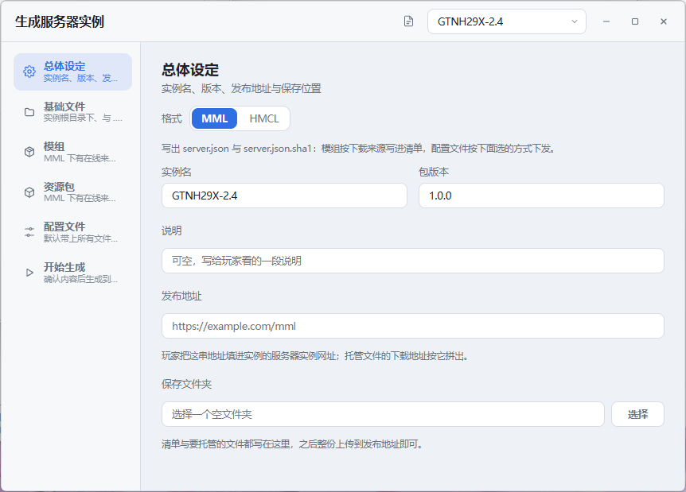
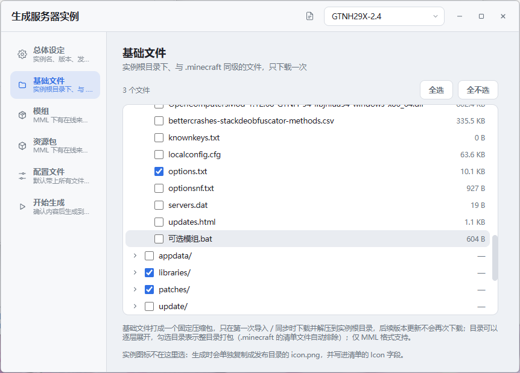
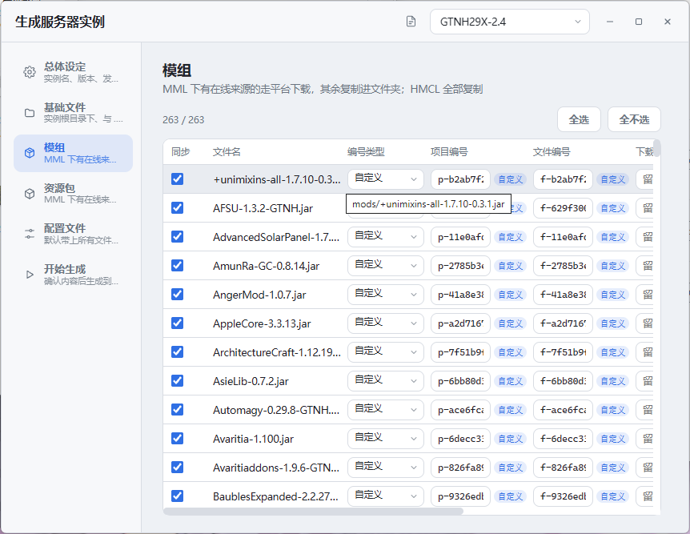
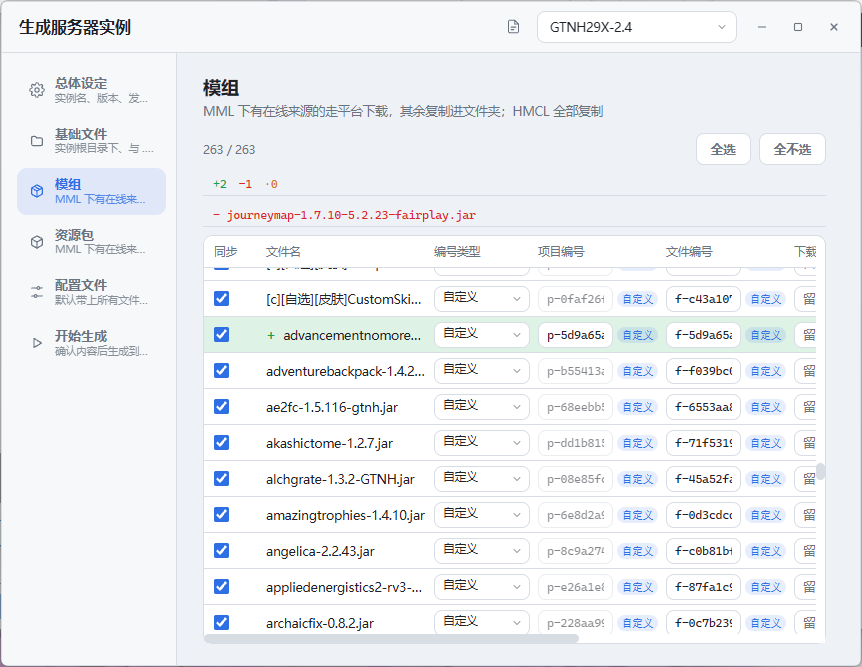
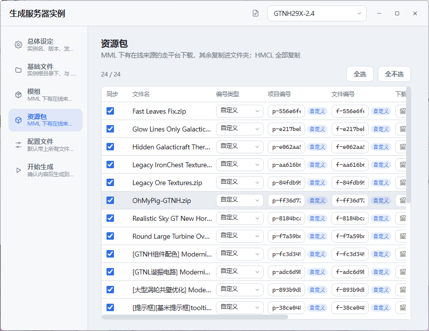
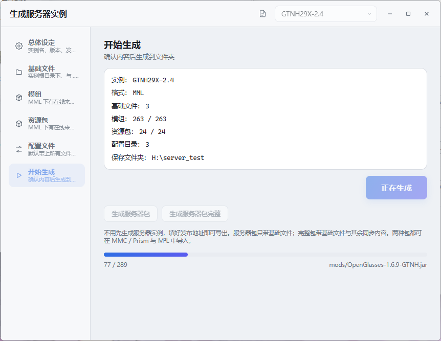
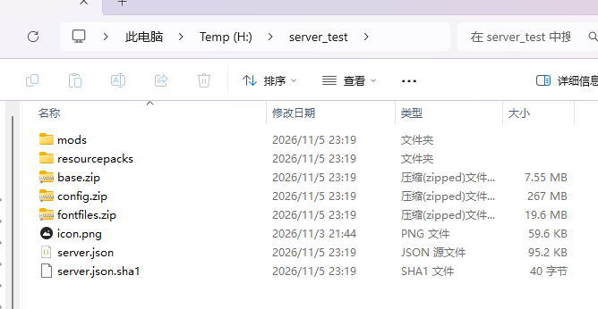

# 服务器实例操作指导

本文讲**服务器实例**从生成、发布到玩家导入、后续更新的完整操作。服务器实例不是服务器包：
服务器包是发给玩家的启动器整合包 zip，服务器实例是放在你自己的网站上、由玩家启动器按清单同步的
在线实例。两者区别见文末。

> 适用版本：0.1.8 起。HMCL 服务器包导入后会转换成本启动器的 MML 服务器实例，旧版本没有这个转换。

## 1. 生成什么

窗口只生成 MML 的 `server.json` + `server.json.sha1`，外加要托管的文件；M²L 玩家用
「添加实例 → 在线实例」导入。**HMCL 玩家不再使用 `server-manifest.json`**：改用下面 3.8 的
MMC 服务器包，HMCL 自己能导入 MMC 格式。

生成从同一个窗口进行：右键实例 → **生成服务器实例**。窗口可以换实例，生成过程不影响
原实例；同一时间只允许一个生成任务。

## 2. 生成前准备

1. **实例本身要能正常玩**：模组、配置、资源包先在本地整理好。生成只是把现有内容写成清单并复制文件，
   不会帮你补模组或修配置。
2. **准备发布地址**：一个能放静态文件的 http(s) 地址，例如 `https://example.com/mml`。
   玩家最终访问的是 `<发布地址>/server.json`。
3. **准备一个空文件夹**：生成不会清空输出文件夹，重复生成到同一目录时旧文件会留下。
   建议每次换一个空目录，或生成前手动清掉上一次的产物。
4. **想清楚哪些配置要同步**：窗口默认会把游戏目录下大部分顶层文件夹设为整包同步，
   包括 `screenshots`、`shaderpacks` 这类通常不需要给服务器的目录，生成前在「配置文件」页
   把不需要的目录改成「不同步」。
5. **模组与资源包只列顶层文件**：放在 `mods/子目录/` 或文件夹形式的资源包不会出现在列表里；
   需要同步就移到 `mods` / `resourcepacks` 顶层，或把资源包压成 zip。

窗口标题栏右侧有「指南」按钮，直接打开这份文档的 GitHub 版本。

## 3. 生成步骤

### 3.1 打开窗口

右键实例 → **生成服务器实例**。标题栏的实例下拉可以换实例；窗口关掉不会中断已经开始的生成。

服务器实例本身已经是同步结果，**不能再当源实例导出**：右键菜单里的入口会置灰，实例下拉里也不会出现。

### 3.2 总体设定



| 字段 | 说明 |
| --- | --- |
| 实例名 | 写进清单的名字，玩家导入后默认用它 |
| 包版本 | 写进 `PackVersion`；**只有版本号变化时客户端才会替换文件**，更新时务必递增 |
| 说明 | 可选，写给玩家看 |
| 发布地址 | 必填，只认 http(s)；末尾斜杠会自动去掉。用它拼托管文件的下载地址 |
| 保存文件夹 | 必填，清单与文件写在这里；**不能放在实例目录里面**，否则下次同步会把生成物当成实例内容 |

生成成功会把实例名、包版本、说明、发布地址、保存文件夹记进实例根目录的
`server_instance_ids.json`，下次打开这个实例时自动回填。

### 3.3 基础文件



- 以实例目录为根，列出可同步的文件与目录；`game.json` / `icon.png` / `server.json` 等
  启动器元数据不列。
- 「全选」会把根目录下的条目全部勾上；目录可以逐层展开，勾 `.minecraft`、`libraries`、
  `patches` 或其中的子目录，整个目录一起进 `base.zip`。`.minecraft` 里的
  `server.json` / `server.json.sha1` / `server.json.old` 会自动排除，`cache` / `temp` /
  `backup` 这些顶层的运行期目录不列。
- 实例图标不在这里选：生成时会单独复制成发布目录的 `icon.png`，并写进清单的 `Icon` 字段。
- 勾选的文件打成一个固定的 `base.zip`，清单里写进 `Base`。
- 客户端**只在第一次导入 / 同步时下载并解压到实例根目录**，后续版本更新不会再下载，也不会覆盖。
- 勾选的基础文件会随生成选项一起保存，下次打开这个实例时自动恢复。
- 适合放 `server.properties`、启动脚本、`eula.txt` 这类与 `.minecraft` 同级、一次配好的文件。
- 只支持 MML 格式。

### 3.4 模组



- 默认全选 `mods` 目录下的顶层文件，可以「全选 / 全不选」或逐行勾选。
- 表格列：同步、可选、文件名、编号类型、项目编号、文件编号、下载地址、哈希值。
- **可选模组**：勾上「可选」后，清单里这条会带 `Optional`，玩家首次同步时文件装成禁用状态
  （`xxx.jar.disabled`，与 MMC / HMCL 的后缀一致），玩家自己启用即可；
  之后再更新时保持玩家当前的启用状态；更新版本换了文件名时按项目号延续，
  玩家启用过的不会被重新禁用。旧版留下的 `.disable` 也认，
  资源包被改名停用时同样不会被重新装回启用。
  它从清单里删掉时，启用和禁用两种文件名都会被清掉。
  客户端同步前会先弹一次确认；可选模组这次会变时再列一个弹窗，玩家可以只更新其中几个，
  没勾的保留本地现有版本，见 [6. 更新](#6-更新)。
- 编号类型可选「在线」或「自定义」；显示编号时去掉 `custom-` 前缀，`Custom` 标记单独表示类型。
- **项目编号 / 文件编号可以直接编辑**；下载地址也可以手填，手填优先于实例记录。
- 没有项目号与文件号时，表格与清单会写一组自定义编号，并标记为「自定义」；
  它不是平台编号，客户端不会拿它去 CurseForge / Modrinth 查询。
- 已经生成过一次的自定义项目编号会锁定，不能再改；只有新增条目才能填新项目编号。
  文件编号仍可改，表格里的哈希值按本地文件内容实时计算。
- **项目编号全局唯一**：模组、资源包、配置文件共用一份编号表；手填编号与其他条目重复时拒绝生成。
  自动生成的编号撞号会追加 `-2`、`-3` 等后缀；旧映射里已有重复项会在读取时自动修复。
- 打开实例后，表格上方就会按上次生成快照显示变化：`+新增` 绿色、`-删除` 红色、
  `·修改` 黄色；新增行前面标 `+`、修改行前面标 `·`，删除的模组不在当前列表里，
  数量与文件名看汇总提示。生成前调整勾选会实时更新，生成后改用本次结果。
- 实例根目录会保存 `server_instance_ids.json`：模组的项目编号按真实 modid 绑定，文件编号按内容 SHA1；
  配置文件与资源包同理。再次生成时项目编号复用、文件编号自动更新，内容变化的模组 / 资源包 / 配置目录
  会在表格里用黄色高亮。
- 同一份文件里还保存上次生成填写的名字 / 版本 / 说明 / 网址 / 保存文件夹，下次打开自动回填。
- 判断规则：
  - 有下载地址，或有项目号 + 文件号：只写进清单，**不复制文件**，玩家从平台或你给的地址下载。
  - 两样都没有：复制进输出文件夹，清单里写托管地址 `<发布地址>/<相对路径>`，并带上自定义编号。
- 某个模组暂时不想发，取消勾选即可；需要重新整理列表时点「全选 / 全不选」。



### 3.5 资源包



- 列出 `resourcepacks` 目录下的顶层文件，默认全选。
- 资源包表与模组表同款：项目编号、文件编号、下载地址都可编辑，显示本地文件哈希；
  已经生成过的自定义项目编号同样锁定，只有新增资源包才能改。
- 和模组页一样，打开实例后就会按上次快照显示 `+新增` / `-删除` / `·修改`；
  新增行绿色 `+`、修改行黄色 `·`，删除的资源包列在红色汇总里。生成前调整勾选实时更新。
- 文件夹形式的资源包不会列出；请压成 zip 再放回 `resourcepacks`。

### 3.6 配置文件

- 以游戏目录为根列出可同步的顶层文件夹，`mods`、`resourcepacks`、`saves`、`logs`、
  `versions`、`libraries`、`assets` 等运行目录不在里面。树按「名称 / 大小 / 同步方式 /
  删除原有目录」四列对齐，文件夹大小是整棵子树的体积。
- 每个文件夹单独选同步方式：
  - **不同步**：这个目录不参与同步；
  - **压缩包整包同步**：整个子树打成一个 `<目录名>.zip`，客户端解压前先删旧目录；
  - **压缩包本目录同步**：只把当前层的文件打成 `<目录名>.zip`，不删客户端目录，
    子目录交给各自的条目；服务端删掉的文件会留在客户端；
  - **逐文件整目录同步**：子树里的文件逐个写进清单，各给一条下载地址；
  - **逐文件本目录同步**：只有当前层的文件逐个写进清单；
  - **删除目录**：生成一个空的 `<目录名>.zip` 并带 `Over`，客户端据此删掉该目录。
- 名称左边的勾选框：文件逐个勾选，默认全勾，取消勾选的不进压缩包 / 清单；目录取消勾选就是
  「不同步」，父目录整包时把它从包里排出去，再勾回来在整包 / 整目录的上级底下恢复成「跟随上级」。
- 「删除原有目录」一列控制**压缩包解压前删不删旧目录**：勾上时客户端先删掉这个目录再解压，
  目录里多余的旧文件不会留下；取消则只覆盖压缩包里的文件。只有自己有压缩包的目录能改，
  删除目录恒为真；「跟随上级」的行显示上层压缩包的设置（灰的）；逐文件 / 不同步的行没有这个设置。
- **压缩包整包同步**下可以继续给子目录下结论：在同步方式里选「不同步」把它从父包里排出去，
  父包仍然会删旧目录，这块内容就整个不再恢复；也可以给子目录单独选方式，让它自己成包。
  下拉里的「跟随上级」表示不单独配，跟着父包走（默认就是它）。
- **逐文件整目录同步**下的子目录仍显示「跟随上级」，不能再选方式，但可以展开勾选里面的文件。
- **删除目录**会锁住整棵子树：子目录不能展开，也不能勾选里面的文件。
- **不同步**会锁住整棵子树：子目录的方式固定为「不同步」，里面的文件也一并灰掉不能勾；
  要单独同步子目录，先把上级改成「本目录」。
- **本目录**只处理当前层：子目录可以各自选方式；没有被任何目录覆盖的文件显示为灰勾，不参与同步。
- 整包同步里把文件全部取消勾选时不会写空包，也就不会删客户端目录；要删就用「删除目录」。
- 第一次打开默认顶层文件夹「压缩包整包同步」，`kubejs` 默认「逐文件整目录同步」。
- 每个目录的同步方式会随生成选项一起保存，下次打开这个实例时自动恢复。
- 空目录选「整包同步」会生成空 zip，等于删掉客户端目录；不想要就选「不同步」。
- 客户端对空 zip + `Over` 的处理：解压前先移走旧目录，发现包里没有文件就不再解压，
  不会留下空文件夹。

### 3.7 开始生成

1. 确认「开始生成」页的汇总：实例、模组 / 资源包数量、配置目录、保存文件夹。
2. 点「生成」。生成中按钮变成「正在生成」，进度条下面显示当前处理到哪个文件。
3. 完成后结果区显示：
   - **清单**：`server.json`；
   - **附带文件**：写进输出文件夹的顶层条目，如 `config.zip`、`mods`、`resourcepacks`、`icon.png`；
   - **同步 N 个文件**：清单里要客户端下载 / 校验的文件总数。
4. 生成失败会在页面上直接显示原因；同一时间只能有一个生成任务，重复点会提示忙。



### 3.8 生成 MMC / Prism / HMCL 服务器包

「开始生成」页下方随时有两个按钮：**生成服务器包**、**生成服务器包完整**。导出前要先在
「开始生成」页生成一次，包里会附带生成出来的 `server.json`；发布地址已填即可。
产物是一个 zip，包内是 MMC 实例结构（顶层一个 `<实例名>/` 目录，含 `mmc-pack.json`、
`instance.cfg`、`game.json` 与 `.minecraft/` 下的 `server.json`、`mml-server-sync.jar`），
拖进 MultiMC / Prism / HMCL 能直接导入，拖进 M²L 会按包内的 `game.json` 自动识别成实例包。

- **内容差别**：**生成服务器包**只含「基础文件」页勾选的内容；**生成服务器包完整**在基础文件之外，
  再带上模组、配置目录、资源包等其余同步内容。包里有什么，取决于「基础文件」页的勾选与「配置文件」页的目录同步方式。
- **同步 agent 放在 `.minecraft`**：`instance.cfg` 的 `JvmArgs` 写相对路径
  `-javaagent:mml-server-sync.jar=<发布地址>/server.json`。MMC / Prism 的工作目录是 `.minecraft`；
  HMCL 导入 MMC 包时把 `.minecraft` 内容摊到实例根，agent 与 `server.json` 都跟着过去，
  相对路径同样成立。玩家侧的操作见 5.2 / 5.3。
- **`game.json` 只给 M²L 用**：写的是 M²L 实例配置（在线服务器实例类型 + 发布地址），**不带** agent 参数；
  M²L 自己按 `server_url` 同步，两套不会重复执行。
- **实例图标会带上**：实例根目录有图标文件（通常是 `icon.png`）时一起放进包根，`game.json` 的
  `Icon` 指向它；`instance.cfg` 的 `iconKey` 就是图标文件名去掉扩展名（如 `gtnh_icon.png` →
  `gtnh_icon`），MMC / Prism 导入时按它在实例根目录找到同名图片并装进自己的图标库。
- **不用另发 jar**：`mml-server-sync.jar` 已随启动器 exe 内嵌，生成时从启动器里解出写进包。
- **带上生成好的 `server.json`**：实例根与 `.minecraft` 各放一份，M²L 与三个启动器的同步 agent
  第一次同步时拿它当旧清单，删除旧文件、可选模组的启用状态才对得上。没有生成过时导出会直接提示先点「生成」。
- **和设置里的「服务器包」不是一回事**：这里只出实例包本身，不带启动器配置，也不带 exe；
  带配置与 exe 的分发包见[软件手册第 16 章](README.md#16-服务器包)。

### 3.9 输出目录长什么样



MML 示例（有在线来源的模组不在里面）：

```text
publish/
├─ server.json              清单
├─ server.json.sha1         清单的 SHA1，必须一起上传
├─ icon.png                 实例图标（有图标时）
├─ base.zip                 基础文件（有选中时，只下载一次）
├─ config.zip               压缩包同步的配置目录
├─ kubejs/                  逐文件同步的配置
│  └─ startup.js
└─ mods/                    没有在线来源、需要你托管的模组
   └─ local.jar
```

> 不要手改 `server.json` 后再上传：`server.json.sha1` 是清单内容的 SHA1，客户端逐字比对，
> 改了清单不改 sidecar 会导致玩家一直认为需要更新。要改内容就用窗口重新生成。

## 4. 发布

1. 把输出文件夹**整份**上传到第 1 步准备的发布地址，保持目录结构不变。
2. 确认这些地址能直接下载（不要登录、不要拦截）：
   - `<发布地址>/server.json`、`<发布地址>/server.json.sha1`、`<发布地址>/icon.png`（有图标时），
     以及清单里所有托管文件的 `<发布地址>/<相对路径>`。
3. 托管地址里，空格与中文已经按 URL 规则转义；确认你的 Web 服务器能正确返回这些路径
   （静态文件服务器一般没问题，自建脚本要注意 URL 解码）。
4. 发布地址建议用 HTTPS；HTTP 能用，但会被浏览器 / 网络环境拦得更多。

## 5. 玩家怎么用

### 5.1 MML 玩家

**方式一（推荐）**：添加实例 → **在线实例** → 填发布地址（填目录或直接填 `server.json` 都认）→
点「下载」。导入时会把模组、配置压缩包与图标同步完，实例建好即可启动；之后每次启动会先取
`server.json.sha1`，与本地清单不同才重新下载。

**方式二**：玩家已有实例时，在实例元信息里把「整合包类型」选成**在线网络整合包**，填上发布地址，
下次启动按同样流程同步。

**方式三（拖入包）**：把 3.8 生成的服务器包 zip 直接拖进**添加实例**窗口，M²L 会按包内的
`game.json` 识别成「在线网络整合包」实例。包内带多少内容取决于选的是「生成服务器包」还是
「生成服务器包完整」，导入后剩下的按在线流程继续同步。

清单里带项目号 / 文件号的模组由客户端从 CurseForge / Modrinth 下载；只有托管地址的从你的发布地址下载。

### 5.2 HMCL 玩家

不再有 `server-manifest.json`。用 3.8 的 MMC 服务器包，HMCL「添加实例 → 从 zip 导入」即可：
HMCL 把包里的 `.minecraft` 内容摊到实例根，`instance.cfg` 的 `JvmArgs` 会写进实例设置，
`mml-server-sync.jar` 与 `server.json` 也跟着到实例根，启动时 agent 按相对路径挂上。
HMCL 的组件解析只支持原版 / Forge / NeoForge / Fabric / Quilt；
OptiFine、LiteLoader、Cleanroom 与自定义加载器导入会失败。

### 5.3 MMC / Prism 玩家

用 3.8 的**生成服务器包**（或**生成服务器包完整**）产出的 zip，拖进 MultiMC / Prism 的
「添加实例 → 从 zip 导入」即可。包内是一个完整的 MMC 实例目录，含 `mmc-pack.json`、
`instance.cfg`、`game.json`、`server.json` 与 `mml-server-sync.jar`。

- **启动前自动同步**：`instance.cfg` 的 `JvmArgs` 带着
  `-javaagent:mml-server-sync.jar=<发布地址>/server.json`；agent 在 `.minecraft` 里，
  MMC / Prism 的工作目录就是它。游戏 main 之前由 agent 按清单同步，同步完才进游戏；
  首次要下基础包，等得久一点是正常的。
- **包内 `server.json` 只当旧清单**：agent 仍按上面的发布地址拉最新清单；实例根这份是首次
  同步时用来比对已有文件的，之后不会自己更新。
- **进度看哪里**：MultiMC / Prism 的 Java 控制台会打印 `[MML-SERVER-SYNC]` 开头的日志，
  同时也写进实例的 `.minecraft/.mml-server-sync/mml-server-sync.log`。下载每秒一条字节进度。
- **工作目录**：agent 默认把启动器的工作目录当游戏目录（MMC 系列一般就是实例的 `.minecraft`）。
  启动器改过工作目录时，在 `instance.cfg` 的 `JvmArgs` 里加
  `-Dmml.serverSync.gameDir=<实例>/.minecraft`。
- **更新**：发布方递增「包版本」并重新上传即可，玩家下次启动自动增量同步；
  版本号没变时只取清单、不动文件。
- **失败**：下载失败会中止启动，不会带着旧文件进服；清单本身拉不到（网络故障、404）时只记日志、
  跳过本次同步，游戏照常启动。
- **不用另发 jar**：`mml-server-sync.jar` 就在包里，agent 是 Java 8 字节码，Java 8–25 都能跑。
- **用 M²L 启动同一个包也不会重复同步**：agent 会认出 MML 启动器并跳过，M²L 自己按
  `game.json` 的发布地址更新。

### 5.4 把 HMCL 服务器包导入 M²L

HMCL 的服务器包（zip 里有 `server-manifest.json`）可以直接拖进添加实例窗口：

1. 添加实例 → **导入压缩包** → 选 zip；启动器会识别成「HMCL 服务器包」。
2. 导入时会**转换成本启动器的 MML 服务器实例**：
   - 实例目录里写一份 `server.json`；
   - 清单里带 `fileApi` 地址的文件按 MML 同步流程下载；
   - HMCL 的 `server-manifest.json` 不留在实例目录里；
   - 实例保持「在线网络整合包」类型和在线信息，之后可以直接启动，也能在「生成服务器实例」里重新导出。
3. `fileApi` 为空时只能使用压缩包里自带的内容；`fileApi` 不可达时导入会失败，
   半成品实例会被删掉。
4. 导入后的实例**不会自动跟随 HMCL 源更新**（没有设置发布地址）。要自动更新，用本窗口重新导出
   MML、发布，并在实例元信息里填上发布地址；或重新导入新的 HMCL 包。

## 6. 更新

### MML

1. 改完实例后重新生成，**输出到一个空文件夹**（或先清掉旧产物），上传覆盖原来的文件。
2. 玩家启动时发现 `server.json.sha1` 变了，会拉新清单；**只有 `PackVersion` 与本地不同才会动文件**，
   版本号没变时只保留本地清单，不替换、不删除任何文件。
3. 版本变化后按清单做增量同步：
   - 基础文件包 `Base` 只在旧清单没有它时下载一次；之后即使清单里换了也不再拉取；
   - 旧清单里有、新清单里没有的文件会删掉；
   - 新清单里有、本地缺失或 SHA1 与清单不一致的文件才下载，哈希一致的跳过；
   - 压缩包同步的配置目录按清单里的 SHA1 判断：哈希没变就不重新下载 / 解压，目标目录被手动删掉才补；
   - 配置压缩包按清单顺序解压，父目录在前、子目录在后；每个包的 SHA1 单独判断；
   - 整包同步与删除目录会先移走客户端旧目录再解压；本目录同步只覆盖当前层的文件，不动子目录；
   - **清单里删掉某条 `Archives` 不会删除玩家本地目录**：已经解压的配置与玩家修改原样保留；
   - 要清理某个目录：把它的同步方式设成「删除目录」（清单里是空 zip + `Over`），
     客户端会移走整个目录，不留空文件夹；
   - 新文件按地址下载并校验 SHA1。
4. 每次改内容都要递增「包版本」；只改文件不改版本，玩家不会更新。
5. 启动时同步过程中点「取消启动」会先问一句：**跳过这次更新继续启动**，还是**结束这次启动**。
   跳过只停同步，已经落地的文件保持现状；下次启动按发布地址重新比对，把没同步完的补上。
6. 同步前会先弹一次确认。清单里标了 `Optional` 的模组这次会变时，再列一个弹窗让玩家挑：
   勾着的下载新版本，没勾的这次跳过，本地旧文件原样留着。跳过会记进**本地**清单的
   `Skipped`（发布端生成的清单里没有这一项），里面记着这次的内容与留下的旧文件；
   发布方下次换了内容时这条记录失效，玩家会再被问一次，这次勾上就换成新版本，
   上次留下的旧文件一并清掉。

### HMCL / MMC / Prism

三边都用 3.8 的 MMC 服务器包；agent 每次启动按发布地址同步，更新方式与 MML 相同：
递增包版本、重新生成、覆盖上传即可。HMCL 如果只重装包而不走 agent，则按它自己的
MMC 导入流程覆盖文件。

## 7. 常见问题

| 现象 | 处理 |
| --- | --- |
| 「生成」按钮是灰的 | 实例 / 实例名 / 发布地址 / 保存文件夹没填全，或一个要同步的内容都没选 |
| 提示输出文件夹不合法 | 选到了实例目录里面；换到实例目录之外 |
| 提示已有生成任务 | 同一时间只能跑一个；等它结束。关掉窗口不会取消任务 |
| 玩家下载 404 | 检查发布地址是否指到目录、有没有多一层文件夹、`server.json` 与托管文件是否都上传了 |
| 玩家一直提示更新 | `server.json` 与 `server.json.sha1` 不匹配；不要手改清单，重新生成并同时上传两份 |
| 玩家的配置没更新 | 先确认包版本递增了；再检查「配置文件」页对应目录的同步方式、逐文件模式的文件是否上传 |
| 服务端删掉的文件在玩家那里还在 | 整包同步会先删旧目录再解压；本目录同步只覆盖当前层，旧文件会保留。整条 `Archives` 删掉不会删目录，要清理就把目录设成「删除目录」 |
| 玩家的文件没变，但清单版本变了 | 检查包版本是否真的递增；版本号没变时同步会直接跳过文件替换 |
| 模组列表里没有某个模组 | 它在 `mods` 的子目录里；移到顶层 |
| 资源包列表里没有某个包 | 它是文件夹形式的；压成 zip |
| 默认带上了截图 / 光影 | 在「配置文件」页把对应目录改成「不同步」 |
| HMCL 导入 MMC 包报加载器不支持 | 换成原版 / Forge / NeoForge / Fabric / Quilt；自定义加载器 HMCL 解析不了 |
| 重新生成后旧文件还在输出目录 | 生成不会自动清理；换空目录或手动删除 |
| HMCL 服务器包导入后不自动更新 | 这是预期：转换只落到本地 MML 清单，没有发布地址 |

## 8. 已知限制

- 生成任务**不能取消**；关掉窗口任务继续，重新打开也看不到进度。
- 输出目录**不会自动清理**，重复生成请用空目录。
- 模组与资源包只列**顶层文件**，子目录与文件夹形式资源包不参与。
- 默认把「除模组 / 存档 / 日志 / 版本 / 库 / 资源等运行目录之外的顶层目录」设为整包同步，
  截图、光影等需要手动改成「不同步」。
- HMCL 导入转换只覆盖压缩包路径；「在线实例」填 HMCL 清单地址、文件夹导入识别 HMCL 服务器包
  目前还没接。
- 转换后的 HMCL 服务器实例没有发布地址，不会自动同步；要在线更新需重新导出 MML、发布，
  并在实例元信息里填上发布地址。

## 9. 和服务器包的区别

| | 服务器包 | 服务器实例 |
| --- | --- | --- |
| 产物 | 一个 zip（实例 + 启动器配置，可选 exe） | 清单 + 托管文件目录 |
| 分发 | 直接发给玩家，拖进启动器导入 | 放到自己的网站，玩家填地址在线导入 |
| 更新 | 重新发 zip，玩家重新导入 | MML 启动时按 SHA1 自动更新；MMC / Prism / HMCL 的 agent 也按发布地址同步 |
| 适用 | 一次性发整合包 / 服务器客户端 | 长期运营、经常更新 |

服务器包的导出与导入见[软件手册第 16 章](README.md#16-服务器包)。
